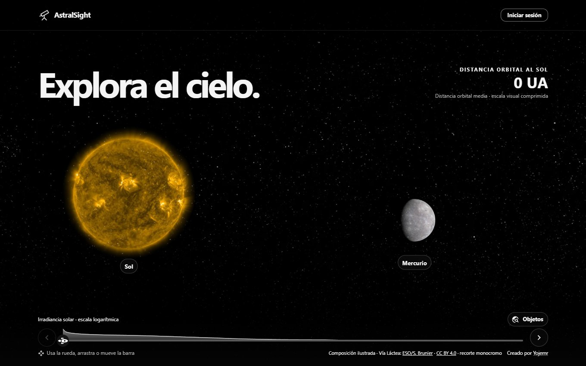
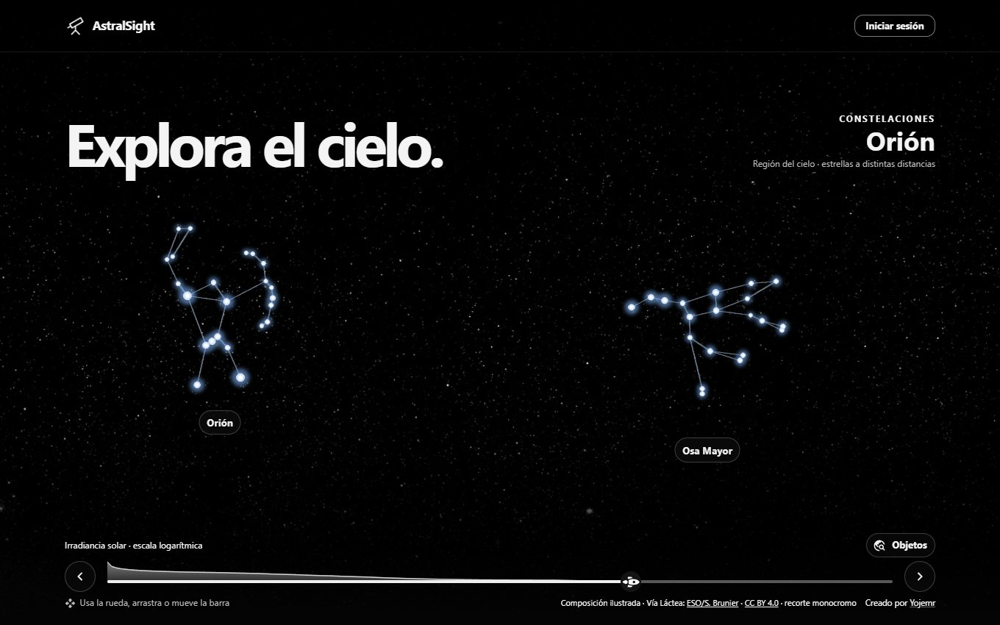
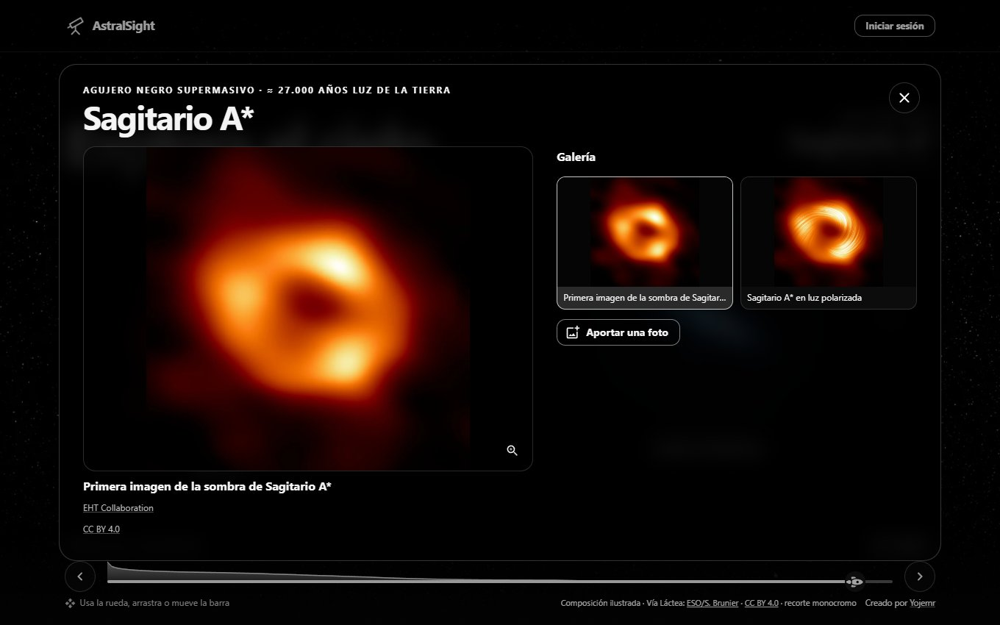
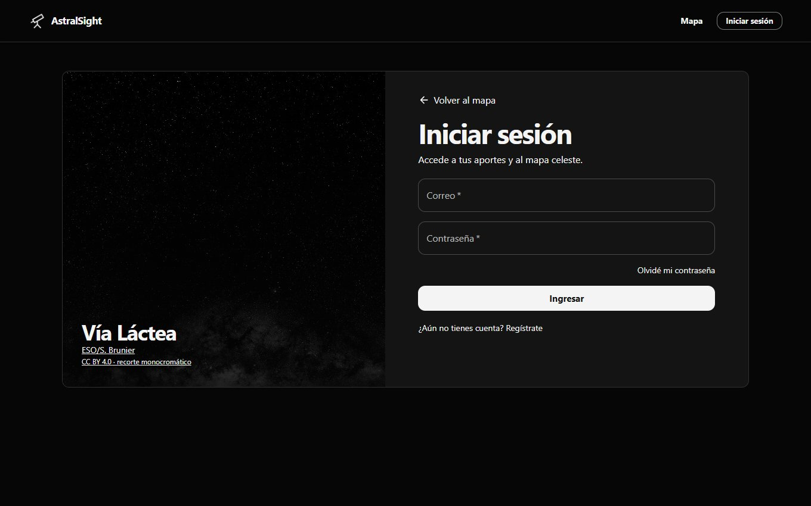
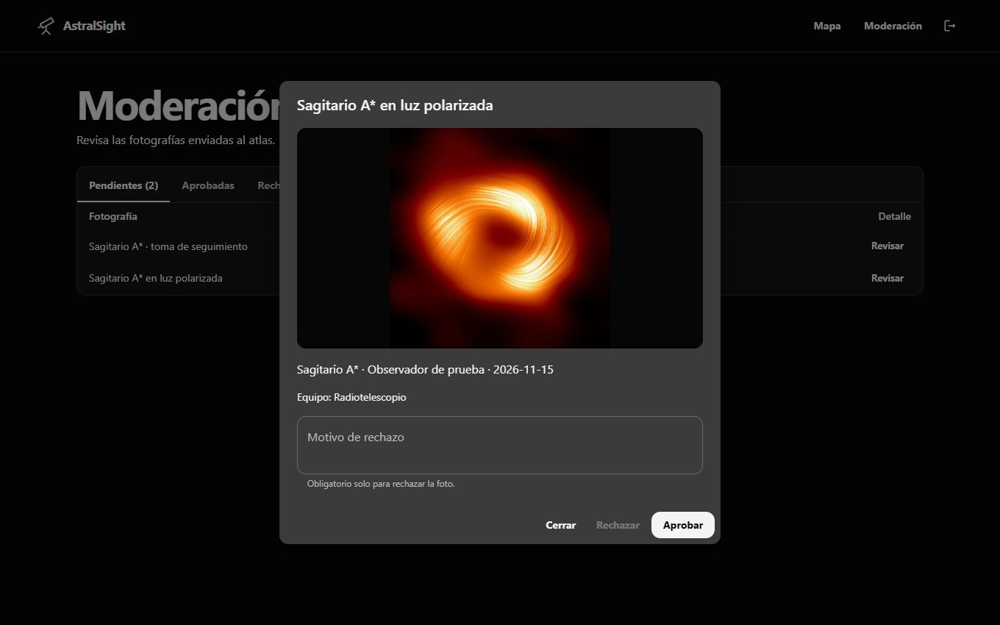

# AstralSight

AstralSight es un atlas astronómico interactivo. Recorre el Sistema Solar desde el Sol hasta Eris y continúa hacia las constelaciones y el cielo profundo. El catálogo reúne **23 objetos** con fichas, imágenes y créditos.

**[Abrir AstralSight en Vercel](https://astralsight.vercel.app/)**

## Vista previa



<details>
<summary>Ver constelaciones, ficha de un objeto, acceso y moderación</summary>

### Constelaciones



### Ficha de Sagitario A*



### Inicio de sesión



### Moderación de aportes



</details>

## Ejecución local

Se requiere Node.js 24 y npm.

```sh
npm ci
npm run dev
```

Abre la dirección local que muestre Vite. Para revisar el código y compilar la versión de producción:

```sh
npm run lint
npm run build
npm run preview
```

GitHub Actions ejecuta la instalación reproducible, el análisis de código y la compilación en cada subida a `main` y en las solicitudes de cambio dirigidas a esa rama.

## Cuentas predeterminadas

| Rol | Correo | Contraseña | Panel |
| --- | --- | --- | --- |
| Usuario | `observador@atlas.test` | `atlas2026` | Mis fotos |
| Administrador | `admin@atlas.test` | `atlas2026` | Moderación |

Son cuentas de prueba de la aplicación frontend. El registro, la sesión y los aportes se guardan en memoria durante la sesión del navegador y se reinician al recargar. La recuperación de contraseña simula la solicitud.

## Funcionalidades

- **Explorador celeste**. La rueda, el arrastre, las flechas y la barra inferior recorren el mismo panorama. Un cohete indica el avance en la barra y el menú agrupa los objetos por tramo. Las fichas incluyen galerías con zoom.
- **Mis fotos**. Permite seleccionar una imagen, revisar la vista previa, aportar datos de la observación y consultar su estado.
- **Moderación**. Permite revisar, aprobar o rechazar aportes. Las fotografías aprobadas aparecen en la galería pública del objeto.
- **Acceso**. Incluye inicio de sesión, registro y recuperación de contraseña dentro de la misma aplicación de una sola página.

## Tecnología

- **React y React Router** mantienen el mapa, los formularios y ambos paneles dentro de una aplicación de una sola página.
- **Material UI** define toda la interfaz con sus componentes, el tema, `sx` y `CssBaseline`. El proyecto prescinde de archivos CSS propios.
- **Vite y Workbox** generan una aplicación web instalable. El mapa y sus imágenes quedan disponibles sin conexión después de la primera visita y de que se complete la descarga de recursos.
- **WebP y carga diferida** reducen el peso inicial del panorama, las imágenes del mapa y las vistas que se abren al interactuar.

## Organización

```text
src/
  features/
    auth/
    explorer/
    moderation/
    observations/
  shared/
public/
  atlas/
  pwa/
```

Cada funcionalidad agrupa sus páginas, componentes, lógica y datos según corresponda. El tema y los componentes compartidos de Material UI definen todos los estilos de la interfaz.

## Datos y fotografías

Los planetas se ordenan por el semieje mayor de sus órbitas según [NASA/JPL](https://ssd.jpl.nasa.gov/planets/approx_pos.html). Las distancias de los planetas enanos son aproximaciones de [NASA Science](https://science.nasa.gov/solar-system/planets/planet-sizes-and-locations-in-our-solar-system/). Una unidad astronómica (UA) equivale a unos 150 millones de kilómetros. Las constelaciones son regiones del cielo con estrellas a distintas distancias, según la [Unión Astronómica Internacional](https://www.iau.org/IAU/Astronomy-FAQs/Constellations.aspx). El mapa usa una distribución ilustrada y una escala visual comprimida. Las imágenes se redimensionan y comprimen para la web. Sus fichas indican la fuente, la autoría y la licencia cuando corresponde.

Haumea, Makemake y Eris se representan en el mapa con vistas renderizadas de los modelos 3D de NASA VTAD. Sus fichas incluyen los renders, enlaces a los modelos originales y las observaciones de Hubble.

El gráfico de la barra muestra la irradiancia solar relativa a la Tierra en escala logarítmica, desde la superficie del Sol hasta la órbita media de Eris. La irradiancia disminuye con el cuadrado de la distancia al Sol. [Referencia de la NASA](https://ntrs.nasa.gov/citations/20230001953).

Las figuras estelares del mapa usan las líneas y magnitudes de [d3-celestial](https://github.com/ofrohn/d3-celestial) de Olaf Frohn, proyectadas en el plano del cielo. [Licencia BSD de las figuras](public/atlas/markers/constellations-LICENSE.txt).

El [panorama de la Vía Láctea](https://www.eso.org/public/images/eso0932a/) es de ESO/S. Brunier y se presenta como un recorte monocromático con contraste ajustado bajo [CC BY 4.0](https://creativecommons.org/licenses/by/4.0/).

## Autoría

Proyecto desarrollado por **Juan Esteban Maya**. [Yojemr en GitHub](https://github.com/Yojemr).
